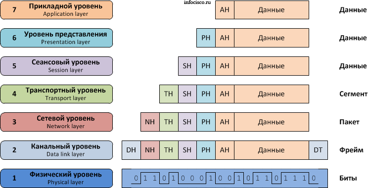
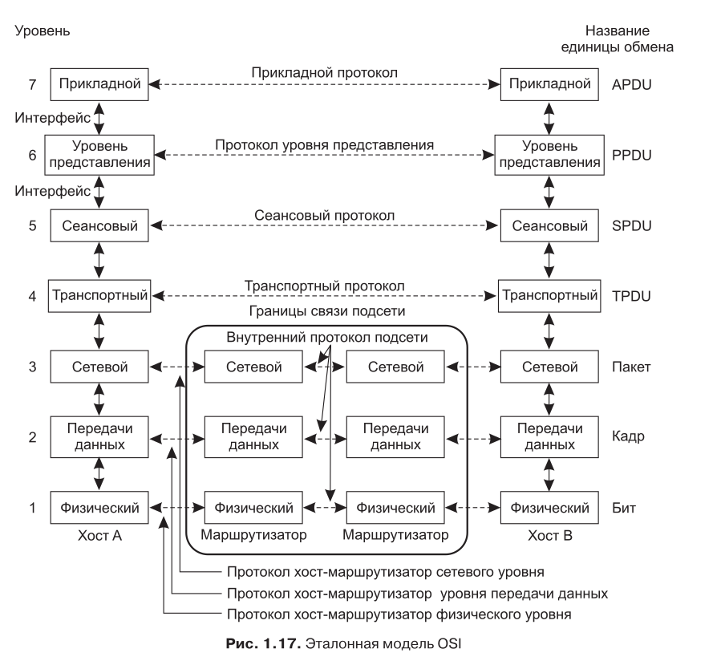
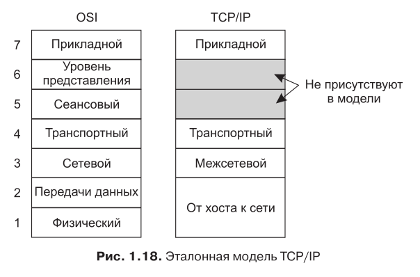
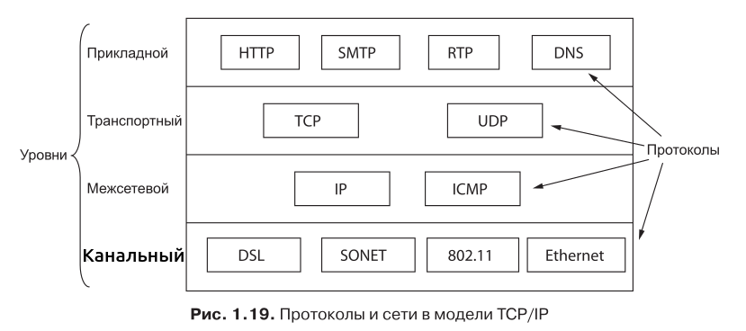
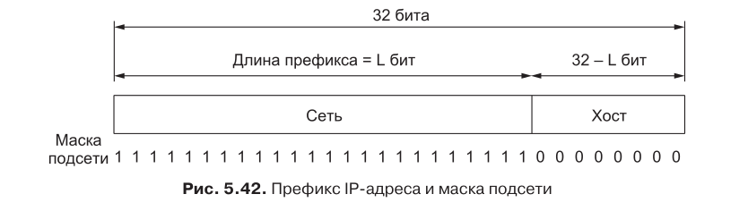
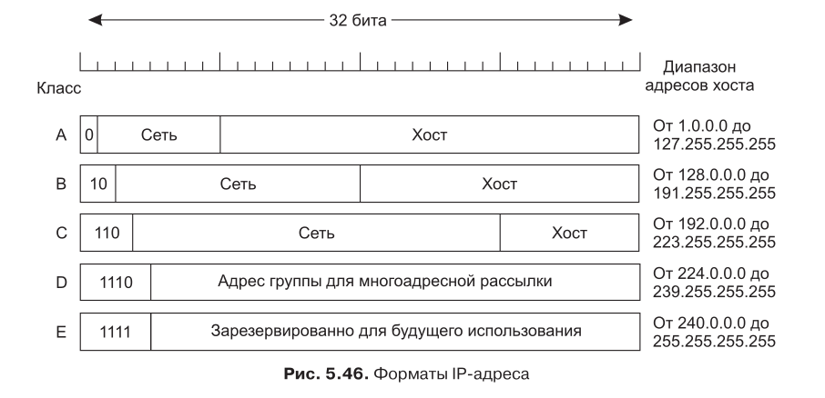

# Организация сетевого взаимодействия
В этой статье попробуем кратко и в простых словах разобраться, кто такие сети, зачем придумали ISO/OSI и TCP/IP и разберёмся с IP-адресацией.

## 0. Введение
Когда ЭВМ начали активно развивать и компьютеров стало много, появилась закономерная потребность: как бы эти компьютеры связать между собой?   

Было бы здорово использовать общие ресурсы. *Например, купить один принтер на весь офис, а не каждому на стол.*   

А ещё компьютеры могли иметь разную мощность. *Удобно хранить на мощном компьютере (**сервере**) большую базу данных компании, а слабенькие компьютеры сотрудников (**клиенты**) просто научить к ней обращаться* 

Также не менее важно было организовать обмен информацией между устройствами.

Для этого компьютеры стали объединять в ***компьютерные сети***. 

>**Компьютерная сеть** – объединение компьютеров (или вычислительных
систем), взаимодействующих через коммуникационную среду.   
***Свойства:***
>* большое число связанных узлов
>* распределение обработки информации
>* расширяемость сети 
>* применение симметричных интерфейсов обмена
информации внутри сети

## 1. Основные понятия
Сеть может разрастись до огромных масштабов *(в сети Интернет около 6млрд человек)*. Каждое устройство может отправлять и обрабатывать данные с разной скоростью, кабели передачи имеют различные характеристики, а по каждому кабелю идёт параллельный обмен информацией сразу между множеством собеседников. 

Чтобы это не превращалось в хаос, общение должно происходить по определённым ***правилам*** в зависимости от целей этого сеанса общения. Эти правила называются ***протоколами***.

А чтобы упростить структуру, большинство сетей делится на ***уровни***, каждый из которых выполняет свою задачу.  
Процесс упаковки данных между уровнями это принцип ***инкапсуляции***.   
Каждый уровень отправителя *(от верхних к нижним)* добавляет от себя **новый заголовок (header)**, который необходим для реализации функций этого конкретного уровня. В работу остальных уровней он не лезет.   
Каждый уровень получателя *(идут снизу вверх)* извлекает свой заголовок, обрабатывает его, а остальные данные не глядя передаёт дальше.

>**Протокол** - правила взаимодействия одноименных (одноранговых) уровней сети.

>**Интерфейс** – набор примитивных операций, предоставляемых нижним уровнем верхнему.

>**Стек протоколов** - список протоколов, используемых системой, по одному протоколу на уровень.

## 2. Эталонная модель ISO/OSI
Модель ISO/OSI имеет семь уровней. Эта модель основана на разработке Международной организации по стандартизации (**International Organization for Standardization, ISO**) и стала стандартом в 1984. 
В 1995 была пересмотрена и стала эталонной моделью взаимодействия открытых систем ISO **(ISO OSI (Open System Interconnection))**.

1. **Физический уровень** занимается реальной передачей необработанных битов по каналу связи.
2. **Уровень передачи данных** *(он же канальный)* обеспечивает возможность передавать «сырые» данные физического уровня по надежной линии связи, свободной от необнаруженных ошибок, и маскировать реальные ошибки, так что сетевой уровень их не видит. Делит поток входных данных на **кадры** некоторого размера, которые отправляются последовательно с обработкой **кадров подтверждения**, отсылаемых обратно получателем.
3. **Сетевой уровень** занимается управлением операциями подсети. Важнейшим моментом здесь является определение маршрутов пересылки пакетов от источника к пункту
назначения.
4. **Транспортный уровень** принимает данные от сеансового уровня,
разбивает их при необходимости на небольшие части, передает их сетевому уровню и гарантирует, что эти части в правильном виде прибудут по назначению.
5. **Сеансовый уровень** позволяет пользователям различных компьютеров устанавливать сеансы связи друг с другом.
6. **Уровень представления** занимается по большей части синтаксисом и семантикой передаваемой информации. Чтобы было возможно общение компьютеров
с различными внутренними представлениями данных, необходимо преобразовывать
форматы данных друг в друга, передавая их по сети в неком стандартизированном
виде.
7. **Прикладной уровень** содержит набор популярных протоколов, необходимых пользователям.

## 3. Эталонная модель TCP/IP
Рассмотрим теперь эталонную модель, использовавшуюся в компьютерной сети ARPANET. Когда появились спутниковые сети и радиосети, возникли большие проблемы при объединении с ними
других сетей с помощью имеющихся протоколов. **Все эти требования привели к выбору сети с пакетной коммутацией, основанной на
уровне без установления соединения, который работает в различных сетях.** Понадобилась новая эталонная архитектура. Первое ее описание встречается в книге Cerf и Kahn (1974),
позднее превращается в стандарт (Braden, 1989).

1. **Уровень доступа к сети** описывает, что должны обеспечивать каналы связи (последовательные линии, Ethernet), чтобы работал межсетевой уровень. *На практике часто называется канальным, но существует тесно взаимодействуя с физическим.*
2. **Межсетевой уровень** является основой всей архитектуры. Его задача заключается в обеспечении возможности каждого хоста посылать пакеты в любую
сеть и независимо двигаться к пункту назначения. Межсетевой уровень определяет официальный формат пакета и протокол IP,
с дополнительным протоколом ICMP.
3. **Транспортный уровень** создан, чтобы объекты одного ранга на приемных
и передающих хостах могли поддерживать связь, подобно транспортному уровню
модели OSI. На этом уровне должны быть описаны два сквозных протокола:   
**TCP (Transmission Control Protocol — протокол управления передачей)** - надёжный протокол с установлением соединения, гарантирует доставку без потерь и в правильном порядке, либо сообщает об ошибке.    
**UDP (User Datagram Protocol — протокол пользовательских дейтограмм)** - ненадёжный протокол без установления соединения, не гарантирует доставку, но выигрывает в скорости.   
***Именно этот уровень определяет тип сервиса: с установлением соединения или без установления соединения.** Мы ещё вспомним об этом при разборе сокетов*
4. **Прикладной уровень** - уровень приложений.Приложения включают все функции сеансов и представления, которые им
нужны.

Взаимоотношения протоколов:

## 4. IP-адресация
>* Размер адреса IPv4 - **32 бита**   
>* Формат записи - 4 числа в диапазоне [0; 255], разделенные точкой   
*Пример: 192.86.0.10*   
>* Делятся на классы A, B, C - для обычных узлов  
D  - групповая рассылка (multicast)   
*E - резерв*

IP-адреса имеют иерархическую организацию. Первая
часть 32-битного адреса имеет переменную длину и задает **сеть**, а последняя часть указывает на **хост**. Сетевая часть совпадает для всех хостов одной сети. Таким образом, сети соответствует непрерывный блок пространства
IP-адресов. Этот блок называется **префиксом (prefix)**.

Длина префикса соответствует двоичной маске, в которой единицы указывают на сетевую часть. Такая маска называется
**маской подсети (subnet mask)**.   
Один из форматов записи - обозначать длину префикса через /число.
>Например: 192.68.0.10/24    
Маска этой подсети: 255.255.255.0   
Адрес подсети: 192.68.0.0   
На адреса хостов выделен последний байт: от 192.68.0.1 до 192.68.0.254 (в этой подсети может быть 254 хоста)

Т.е. адрес подсети получается логическим умножением ip-адреса на маску.

IP-адреса делятся на классы, это называется **полноклассовая адресация**. Мы не будем углубляться в детали, как это помогло людям, но раньше это использовалось для оптимизации выбора маршрута, а сейчас пригодится вам на экзамене и в решении задач:

* Класс определяется по первым битам
* Число хостов определяется формулой   
>2n - 2, где n - количество бит, выделенных под адрес хоста   
*A: n=24   
B: n=16   
C: n=8*

Почему вычитаем 2? Существуют 2 зарезервированных  адреса: **адрес самой сети** (со всеми нулями в битах хоста) и **широковещательный** (с единицами в битах хоста).

>Например для 192.68.0.10/24   
Широковещательный: 192.68.0.255 

Отправка на ***широковещательный адрес*** рассылает сообщение **всем хостам** в этой подсети.

## 5. Порядок байт
Байты на компьютере чаще хранятся в порядке ***Little-Endian (LE)*** - *младший байт первый*. Для нас это как читать байты с конца.

А вот в сети данные передаются в порядке ***Big-Endian (BE)*** - *старший байт первый*. Для нас это привычный формат, читается слева направо.
>Например, 16-ричное число 0x12345678 занимает 4 байта:   
BE: 12 34 56 78   
LE: 78 56 34 12

Поэтому при написании программ для передачи данных по сети требуется следить за порядком байт.    
*В си это функции htonl(), ntohl(). Подробнее о них в статье про сокеты.*
