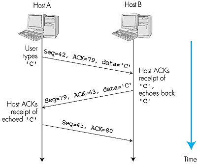
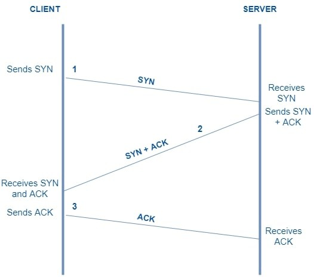
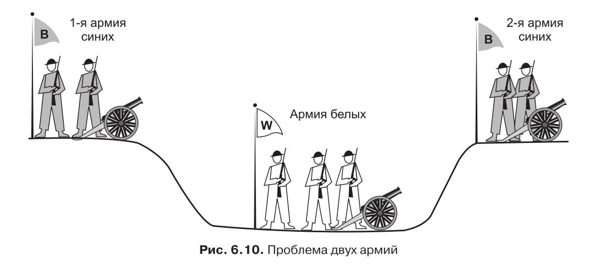
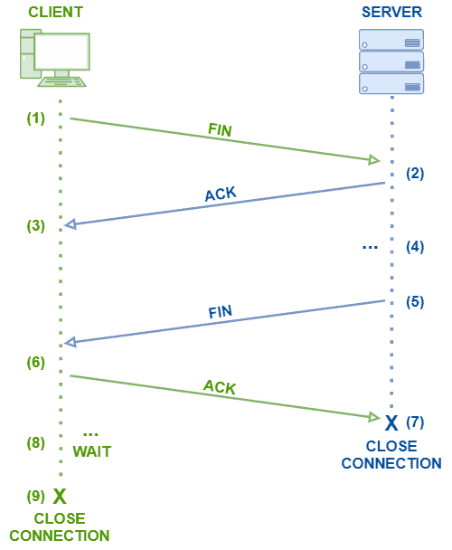
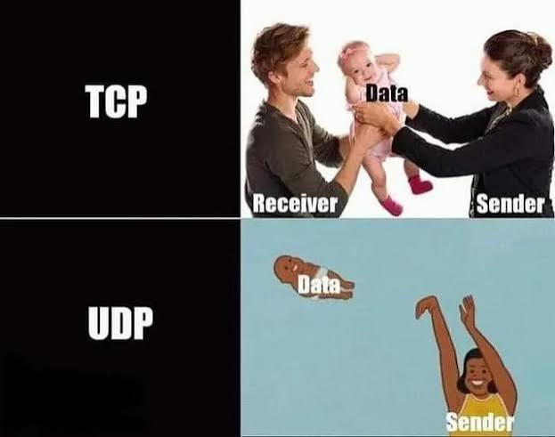
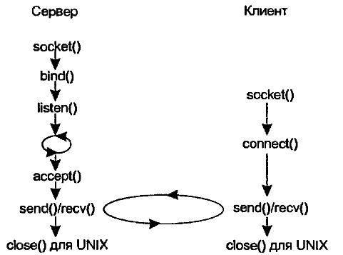
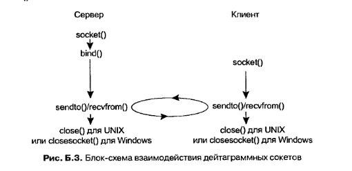
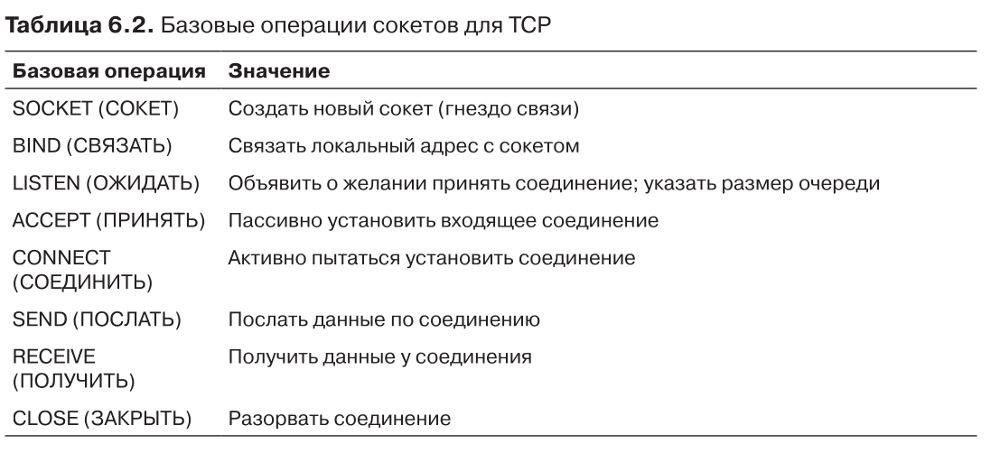

# Сокеты
В этой статье разберём транспортные протоколы TCP и UDP, механизм сокетов, схемы с установлением соединения и без, а также их программную реализацию

## 0. Введение. Сокеты Бёркли.
Изначально процессы научились обмениваться данными внутри одного компьютера. Этот обмен подразумевает, что канал связи между процессами является абсолютно надёжным, ведь все данные находятся на одном физическом устройстве. Процессы отправляют и получают непрерывный поток байт.

Но что делать процессам, запущенным на двух разных компьютерах?    
Во-первых, нужна общая система именования, которая актуальна не только внутри одной ОС.   
Во-вторых некоторые процессы тоже хотят абсолютно надёжный канал связи, из которого можно просто читать данные. Им не нужна информация о потерях, перегрузках и тд. Но данные в сети спокойно могут потеряться или прийти не в том порядке.   
Чтобы процессы не чувствовали разницы, запущены они внутри одного устройства или на разных, придумали **сокеты**.

>**Сокет** - программный интерфейс для обеспечения информационного обмена между процессами

Впервые сокеты стали применяться в 1983 году в операционной системе Berkeley UNIX 4.2BSD.

## 1. Типы сокетов
В конспектах лекций по ОСям представлено два типа сокетов, определяемых типом соединения:
* ***соединение с использованием виртуального канала*** - *SOCK_STREAM*
* ***датаграммное соединение*** - *SOCK_DGRAM*

В сети эти сокеты работают на ***транспортном уровне*** модели TCP/IP и реализуют функционал протоколов ***TCP (предварительное соединение)*** и **UDP (датаграммы)**.  

Глобально, бывают и другие. Например, *SOCK_RAW* (так называемые сырые сокеты) работает напрямую на сетевом уровне и контроль транспорта оставляет пользователю.   
Также упоминается *SOCK_SEQPACKET*, который объединяет хорошее из двух рассматриваемых в курсе типов: использует виртуальный канал, гарантирует надёжность, но сохраняет границы сообщений. Но подробно его в курсе не рассматривают - и мы не будем.

### Соединение с использованием виртуального канала
Это соединение с гарантией надёжной доставки. Как раз при нём процессы чувствуют себя так, будто находятся внутри одного устройства и напрямую соединены виртуальным каналом.   
Амбассадор такого соединения - **протокол TCP**. Для лучшего понимания хочется упрощенно прояснить, как это устроено внутри.   
Чтобы наводить порядок в приходящем потоке байт, используются:   
* **Подтверждения.** К каждой отправленной порции данных отправитель приписывает два числа:    
***SEQ (sequence number)*** - номер первого байта, который я отправил в этой порции    
***ACK (acknowledgement number)*** - какой следующий по счёту байт данных я жду от тебя
* **Таймауты.** Если в seq-ack что-то не сходится, подтверждение не пришло вовремя - надо предпринимать действия
* **Повторные отправки.** Когда таймаут истёк или пришло несколько одинаковых ACK (собеседник просит один и тот же байт), можно повторно отправить данные, на которые не пришло подтверждения.

С использованием этих средств, TCP в ядре приводит приходящие байты в порядок и отдаёт дальше уже ровным потоком.  



В общем работа TCP это своего рода пинг-понг из подтверждений. По той же схеме работает установление соединения **(трёхстороннее рукопожатие)**.

    
*SYN - специальный флаг начала соединения*
1. Клиент отправил SYN - запрос на подключение
2. Сервер отправил ACK, что получил запрос на подключение и SYN - свой запрос на подключение.
3. Клиент отправил ACK - подтверждение, что получил запрос от сервера.   

Победа, соединение установлено!

Стоит отметить, что для однозначного определения соединения используются пары ip-адрес + порт.   
**Т.е. каждое соединение определяется четырьмя значениями:    
ip_src (ip source) - адрес отправителя   
ip_dst (ip destination) - адрес получателя   
port_src - порт отправителя   
port_dst - порт получателя**   
*Порты в диапазоне 0-1023 зарезервированы под общеиспользуемые прикладные протоколы, например 80 порт используется HTTP*

>*Примечание*   
С отключением сложнее, это так называемая ***проблема двух армий***

>Предположим, командир первой армии синих посылает следующее сообщение:
«Я предлагаю атаковать 29 марта, на рассвете. Сообщите ваше мнение». Теперь предположим, что сообщение успешно доставляется и что командир 2-й армии синих соглашается, а его ответ успешно доставляется обратно в 1-ю армию синих.   
Состоится
ли атака? Вероятно, нет, так как командир 2-й армии не уверен, что его ответ получен.
Если нет, то 1-я армия синих не будет атаковать, и было бы глупо с его стороны в одиночку ввязываться в сражение.   
Теперь улучшим протокол с помощью «тройного рукопожатия». Инициатор оригинального предложения должен подтвердить ответ. Но и в этом случае останется неясным, было ли доставлено последнее сообщение. Протокол четырехкратного рукопожатия здесь также не поможет.

Проблема двух армий не имеет решения, в TCP она смягчается таймаутами. А для закрытия соединения используется обычное четырёхкратное рукопожатие. Это удобно, потому что необязательно закрывать соединение одновременно: можно перестать отправлять данные, но принять оставшиеся от собеседника.
    
*FIN - специальный флаг, сигнализирующий, что больше данные отправляться не будут*

### Датаграммное соединение
Тут всё намного проще. Устанавливать соединение не будем, проверять дошли ли наши данные - тоже, зачем?   
Амбассадор этого соединения - ***протокол UDP***. Суть UDP в том, чтобы просто отправить пакет (a.k.a. датаграмму) в сеть и подписать "кому". Если датаграмма не дошла или не влезла в канал передачи - это уже не проблемы UDP, он изначально ничего не гарантировал.



## 2. Схемы работы
### С установлением соединения 

### Без установления соединения

## 3. Реализация сокетов
У сокетов есть набор базовых операций, которые позволяют осуществлять соединения и передачу данных.

Рассмотрим реализацию в си.

### Создание сокета
```c 
#include <sys/types.h>
#include <sys/socket.h>

int socket (int domain, int type, int protocol);
//в случае успеха возвращает дескриптор сокета, иначе -1
```
*Дескриптор сокета ОС воспринимает как файловый дескриптор*
```c
args:
	domain - коммуникационный домен сокета. 
		AF_UNIX - домен локального взаимодействия (внутри ОС)
		AF_INET - домен сетевого взаимодействия (в сети)
	type - Тип соединения
		SOCK_STREAM - соединение с установлением виртуального канала
		SOCK_DGRAM - датаграммное соединение
	protocol - протокол взаимодействия для создания соединения в домене
		0 - Автоматический выбор // (нам подходит)
		IPPROTO_TCP - протокол TCP для AF_INET + SOCK_STREAM
		IPPROTO_UDP - протокол UDP для AF_INET + SOCK_DGRAM
```
### Привязка сокета
```c
#include <sys/types.h>
#include <sys/socket.h>

int bind (int sockfd, const struct sockaddr *addr, socklen_t addrlen);
//в случае успеха возвращает 0, иначе -1
```
*Назначает сокету локальный адрес.   
Для AF_INET - привязывает сокет к паре IP + порт.   
Для AF_UNIX - создаёт файл. Если такой файл уже существует - будет ошибка*
```c
args:
	sockfd - дескриптор сокета (результат socket())
	addr - указатель на структуру адреса, приводится к (struct sockaddr *)
		AF_UNIX: struct sockaddr_un   
                 { sun_family = AF_UNIX;    
                 sun_path = имя файла; }
		AF_INET: struct sockaddr_in   
                { sin_family = AF_INET;    
                sin_port = порт;    
                sin_addr.s_addr = IP-адрес; }
			// порт и адрес задаются в сетевом порядке байт: htons(), htonl()
			// INADDR_ANY - любой адрес этого компьютера
	addrlen - размер структуры адреса в байтах
```

### Прослушивание (только SOCK_STREAM, сервер)
```c
int listen (int sockfd, int backlog);
//в случае успеха возвращает 0, иначе -1
```
*Переводит сокет в режим ожидания клиентов. Сокет уже должен быть привязан через bind*
```c
args:
	sockfd - дескриптор сокета
	backlog - максимальная длина очереди ожидающих соединений
```

### Установление соединения (клиент; для SOCK_DGRAM необязательно)
```c
int connect (int sockfd, const struct sockaddr *addr, socklen_t addrlen);
//в случае успеха возвращает 0, иначе -1
```
*Блокирует процесс, пока соединение не будет установлено. Привязывать клиентский сокет через bind не обязательно, система может назначить адрес и порт автоматически*
```c
args:
	sockfd - дескриптор сокета
	addr - адрес сервера
	addrlen - размер структуры адреса
```

### Принятие соединения (только SOCK_STREAM, сервер)
```c
int accept (int sockfd, struct sockaddr *addr, socklen_t *addrlen);
//в случае успеха возвращает дескриптор НОВОГО сокета, иначе -1
```
*Блокирует процесс, пока не придёт клиент. Новый сокет - для общения с этим клиентом, sockfd продолжает слушать*
```c
args:
	sockfd - дескриптор слушающего сокета
	addr - сюда запишется адрес клиента (можно NULL)
	addrlen - на входе размер буфера под адрес, на выходе реальный размер
```

### Обмен данными (SOCK_STREAM)
```c
ssize_t send (int sockfd, const void *buf, size_t len, int flags);
ssize_t recv (int sockfd, void *buf, size_t len, int flags);
//возвращают число переданных/принятых байт, иначе -1
//recv вернёт 0, если собеседник закрыл соединение
```
*Границы сообщений не сохраняются: один recv не равен одному send. Может быть передано меньше, чем запрошено*
```c
args:
	sockfd - дескриптор сокета (после connect или accept)
	buf - буфер с данными (send) / буфер для приёма (recv)
	len - длина данных (send) / размер буфера (recv)
	flags - 0 - по умолчанию
		MSG_OOB - срочные данные
		MSG_PEEK - прочитать, не удаляя данные из очереди (recv)
```

### Обмен данными (SOCK_DGRAM)
```c
ssize_t sendto (int sockfd, const void *buf, size_t len, int flags,
                const struct sockaddr *dest_addr, socklen_t addrlen);
ssize_t recvfrom (int sockfd, void *buf, size_t len, int flags,
                  struct sockaddr *src_addr, socklen_t *addrlen);
//возвращают число переданных/принятых байт, иначе -1
```
*Одна датаграмма = один вызов. Адрес указывается в каждом вызове. Если буфер меньше датаграммы, остаток теряется*
```c
args:
	sockfd, buf, len, flags - как в send/recv
	dest_addr - адрес получателя (sendto)
	src_addr - сюда запишется адрес отправителя (recvfrom), можно NULL
	addrlen - размер структуры адреса (в recvfrom: на входе размер буфера, на выходе реальный размер)
```

### Завершение соединения
```c
int shutdown (int sockfd, int how);
//в случае успеха возвращает 0, иначе -1
```
*Закрывает соединение полностью или в одном направлении, дескриптор остаётся открытым*
```c
args:
	sockfd - дескриптор сокета
	how - 0 (SHUT_RD) - запретить приём
	      1 (SHUT_WR) - запретить передачу
	      2 (SHUT_RDWR) - запретить и то, и другое
```

### Закрытие сокета
```c
#include <unistd.h>

int close (int fd);
//в случае успеха возвращает 0, иначе -1
```
*Освобождает дескриптор. Соединение разрывается, когда закрыт последний дескриптор сокета. Для AF_UNIX файл сокета не удаляется - нужен unlink()*

### Порядок байтов и адреса
```c
#include <arpa/inet.h>

uint16_t htons (uint16_t hostshort);   //порядок хоста -> сетевой (16 бит, порт)
uint32_t htonl (uint32_t hostlong);    //порядок хоста -> сетевой (32 бита, IP)
uint16_t ntohs (uint16_t netshort);    //сетевой -> порядок хоста (16 бит)
uint32_t ntohl (uint32_t netlong);     //сетевой -> порядок хоста (32 бита)

in_addr_t inet_addr (const char *cp);  //"192.168.0.1" -> число в сетевом порядке, ошибка: INADDR_NONE
char *inet_ntoa (struct in_addr in);   //число -> строка 
```
*Сетевой порядок байт - big-endian. inet_addr и inet_ntoa считаются устаревшими: им на замену пришли inet_pton и inet_ntop*


## 4. Пример 
Чтобы потыкать ручками, скачайте из папки ***code*** файлы "client.c" и "server.c"   
Откройте два терминала. В одном запустите сервер:
```
gcc -Wall -Wextra -o server server.c
./server
```
Во втором клиент: 
```
gcc -Wall -Wextra -o client client.c
./client "Я сдам ОСи!"
```
А дальше наблюдайте изменения в терминале сервера, когда запускаете очередного клиента.