# Особенности структуры виртуальной памяти

Итак, для запуска и работы программы её необходимо сперва поместить в оперативную память (ОЗУ). И здесь управление оперативной памятью должно решать следующие основные задачи:

1. осуществление контроля использования ресурса (помнить, какие ячейки заняты/свободны)
2. выбор стратегии распределения (какому процессу даётся в пользование ресурс, насколько много и как долго)
3. непосредственно выделение ресурса
4. выбор стратегии освобождения памяти. Здесь может подразумеваться как окончательное освобождение (например, при завершении процесса), так и временное освобождение (когда происходит выгрузка во внешнюю память/ПЗУ для предоставления ресурса другому процессу)

## Основные стратегии распределения

Мы рассмотрим 6 основных способов распределения оперативной памяти в порядке их "эволюции":

1. одиночное непрерывное распределение
2. распределение неперемещаемыми разделами
3. распределение перемещаемыми разделами
4. страничное распределение
5. сегментное распределение
6. сегментно-страничное распределение

### 1. Одиночное непрерывное распределение

Самая примитивная модель. Делим всю память на две части - в одной будет функционировать непосредственно ОС, во второй - пользовательский процесс.

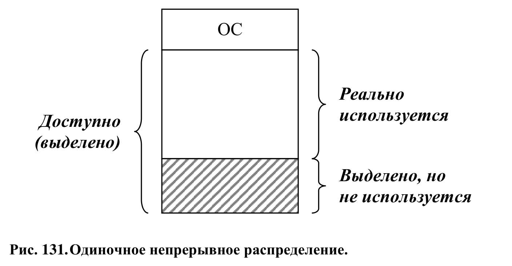

Из дополнительного - необходим регистр для хранения границы пространства ОС. Если адрес больше регистра - память относится к пользовательскому процессу. Меньше - к ОС.

Очевидные недостатки:

- неэффективное использование памяти (к части ресурсов обращений может не быть вовсе)
- загруженный процесс использовал сразу всю память
- ограничение максимального размера программы

### 2. Распределение неперемещаемыми разделами

Оставляем разделение на 2 части - ОС и пользовательскую.

Однако теперь пользовательское пространство памяти делим ещё на N частей (разделов). В общем случае каждый раздел может иметь произвольный фиксированный размер.

Аппаратно существует два способа поддержки такого разделения

1. Использование для каждого раздела двух регистров границы (начало и конец). Выход адреса за границы - прерывание
2. Для каждого раздела ОЗУ ставится в соответствие "ключ защиты". У процесса, который занял раздел, также есть этот ключ защиты. При обращении процесса к участку памяти проверяется совпадение данных ключей. (называется PSW — process[or] status word)

Из дополнительного аппаратного - каждый процесс должен иметь "регистр базы" для корректной адресации, совпадающий с одним из регистров границы.

Алгоритмов в данной модели распределения также 2

#### Вариант А. N входных очередей

При варианте A создаётся N очередей для процессов, каждая из которых соответствует своему разделу.

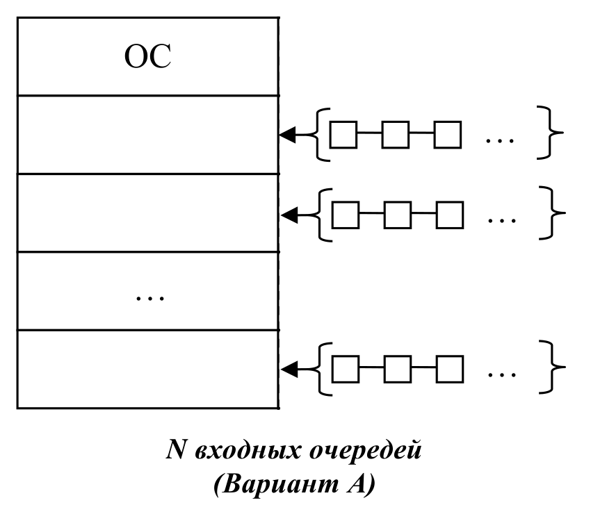

Сортировка входных процессов по очередям в данном случае обычно сводится к помещению процесса в очередь, соответствующую разделу минимального размера, способному поместить в себя процесс. Из-за такого подхода на одни разделы может возникнуть очередь, когда в других память будет простаивать. Крайне неэффективное использование

#### Вариант B. 1 входная очередь

Вторым вариантом является выделение лишь одной очереди под все процессы.

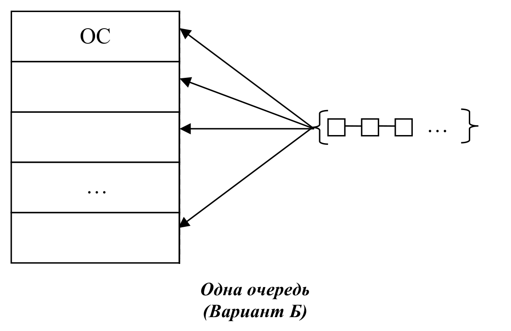

И снова два варианта под капотом!

1. Просто выбираем под освободившийся раздел первый процесс из очереди. Просто, но так мы можем поместить "маленький" процесс в большой раздел - неэффективное использование памяти
2. Проходим всю очередь для поиска процесса максимального размера, умещающегося в данный раздел.

Второй подход дискриминирует "малые" процессы. Решение - добавление счётчика, который увеличивается за каждое "невзятие" процесса в раздел. При достижении определённого числа ОС будет обязана взять процесс в освободившийся раздел

Из преимуществ данной модели распределения:

- относительная простота реализации
- несколько процессов свободно находятся в ОЗУ, и процессор может быстрее переключаться между выполняемыми процессами

Недостатки:

- всё ещё фрагментация (внутри каждого раздела остаётся неиспользуемая память)
- ограничение размера процесса
- предварительное деление на N разделов
- размещение всего процесса в ОЗУ (часть данных всё ещё может не использоваться)

### 3. Распределение перемещаемыми разделами

При данном распределении процессы загружаются в память "последовательно". Основной "шаг эволюции" в данном методе - избавление от фрагментации.

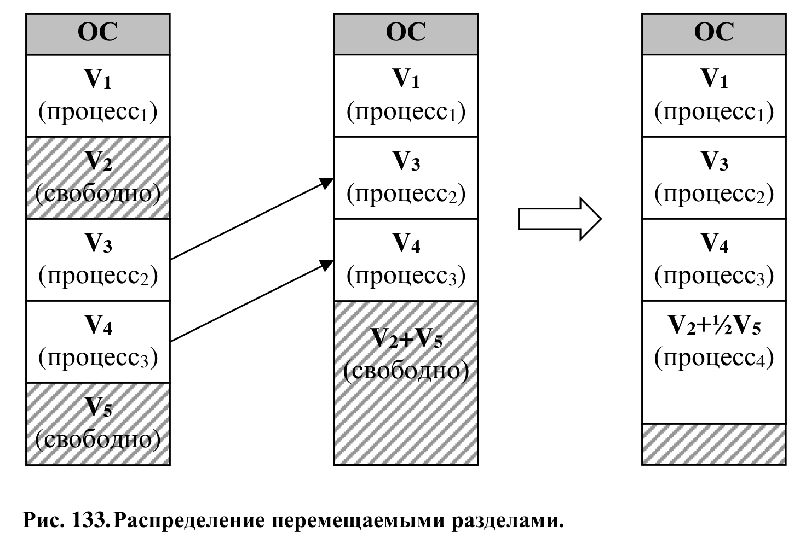

Стратегии "компрессии" (перемещение разделов для объединения блоков свободной памяти) могут быть разными (нам надо как можно сильнее оптимизировать перемещение разделов, т.к. это сильные затраты на время), в их детали вдаваться не будем.

Из аппаратного необходимого - также регистры границ или ключ защиты, регистр базы, а также механизм, позволяющий двигать весь процесс в памяти.

Отдельно данная система хорошо себя показывает, когда каждый процесс является "большим вычислительным", т.е. достаточно долго сидит в памяти, чтобы время на компрессию не было таким значимым.

Преимущества:

- все прошлые + уменьшение фрагментации

Недостатки:

- компрессия может занимать значительное время на перемещение разделов
- все прошлые (не считая фрагментации)

### 4. Страничное распределение

Наконец мы подходим к более вкусным реализациям. В том числе к появлению _виртуального адресного пространства_. (дальше будет много всякого...)

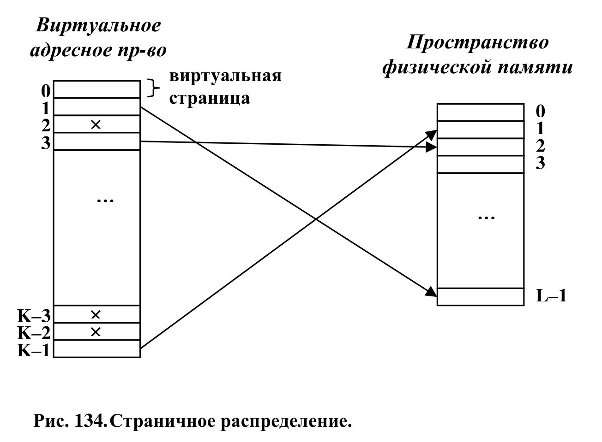

В чём суть? Теперь мы делим наше пространство оперативной памяти на множество (удобней брать `pow(2, n)`) фрагментов одинакового размера (страниц). Далее вводим:

- виртуальное адресное пространство - пространство, с адресами которого оперирует программа
- физическое адресное пространство - реальная память, что есть в компьютере
- соответствие между виртуальными и физическими страницами (таблица страниц). Таблица страниц (непосредственное соответствие между вирт и физ памятью) предполагается своя для каждого процесса.

Механизм преобразования адреса из виртуального в физический при таком подходе элементарный - заменяем номер виртуальной страницы на физический, offset остаётся прежним.

Однако возникает проблема хранения такой таблицы (обращаться к ней надо постоянно, а хранить её целиком в ближайших регистрах представляется маловероятным). Хранение такой таблицы в ОЗУ, очевидно, вызывает большую просадку в скорости работы машины. (Даже с учётом работы кэша L-уровней)

Запись в таблице может представляться разными способами, ниже показан типовой пример:

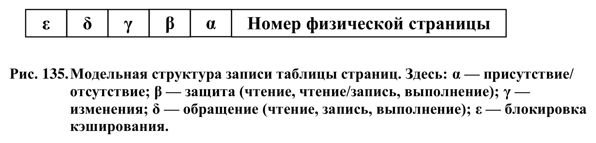

Например, благодаря таким атрибутам мы можем запретить запись в какую-либо страницу, проверить её наличие вовсе или запретить кэширование.

#### TLB

Одним из примеров оптимизирования является **TLB** (Translation Lookaside Buffer), представляющий собой кэш для таблицы страниц.
TLB размещается непосредственно аппаратно внутри процессора.

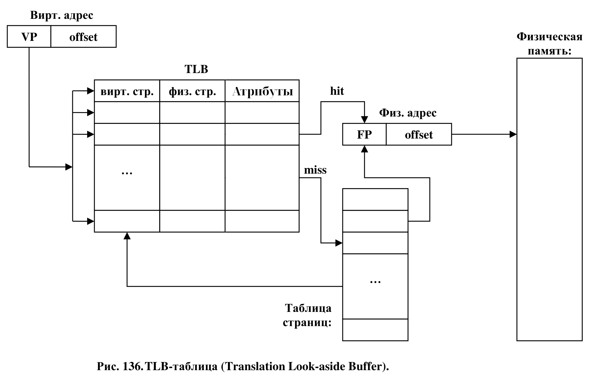

Таблица состоит из небольшого числа строк (8-128) и содержит концептуально три столбца - номер вирт страницы, номер физ страницы и атрибуты. Сам виртуальный адрес состоит из номера виртуальной страницы (VP) и смещения в ней (offset). Процессор выполняет быстрый поиск по данной таблице для нахождения нужной записи, аппаратно проверяет корректность атрибутов и, если всё корректно, заменяет номер виртуальной страницы на физический.

В случае cache-miss выбрасывается самая старая запись, на её место ставится запись, соответствующая текущему проверяемому вирт адресу -> проверки атрибутов -> замена на номер физ страницы. (Отдельно отметим, что атрибут запрета кэширования не относится к TLB, он относится к кэшированию процессором на L-уровнях)

Главные возникающие недостатки - при смене контекста (переключение на другой процесс) система обязана поменять как TLB-таблицу, так и таблицу страниц. Помимо этого всё ещё требуется где-то хранить большое множество больших таблиц страниц.

#### Иерархическая организация

Одним из способов решения проблемы является введение *иерархической организации таблицы страниц*. В данном подходе номер страницы просто бьётся на несколько, вследствие чего появляются уровни. (В некоторых случаях это может быть до четырёхуровневой иерархии)

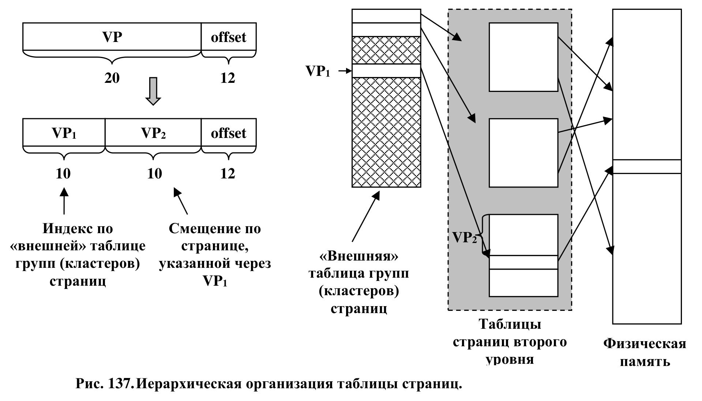

Данный подход замечателен тем, что вместо хранения одной большой таблицы нам необходимо иметь "под рукой" лишь таблицу первого уровня и несколько таблиц второго. (Обращения в память зачастую происходят в +/- одни и те же локальные области)

Но начиная с определённого уровня иерархии механизм работы не окупается из-за накладных расходов.

#### Хэш-таблицы

Следующей умной мыслью людей было использование хэш-таблиц. (Хэш, надеюсь, вы знаете; найдёте сами)

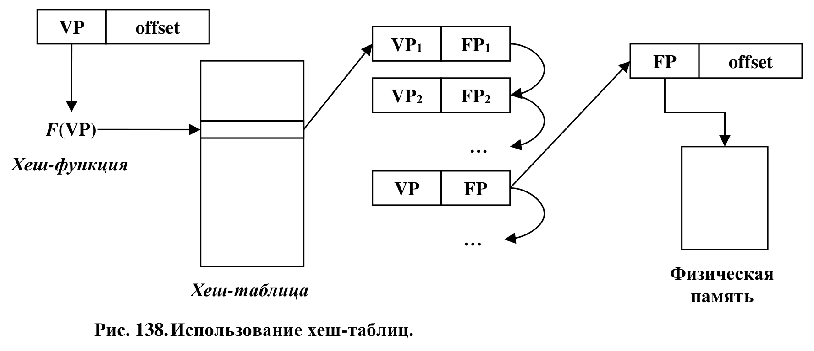

При данном подходе через хэш-функцию прогоняется номер виртуальной страницы, а далее ищется её соответствие среди пар (VP, FP) в списке коллизий.

Более того, данный алгоритм может использоваться непосредственно с TLB при промахе кэша.

#### Инвертированная таблица страниц

Ещё одним решением является использование *инвертированной таблицы страниц*. Основная концепция - добавление использования PID в виртуальном адресе.

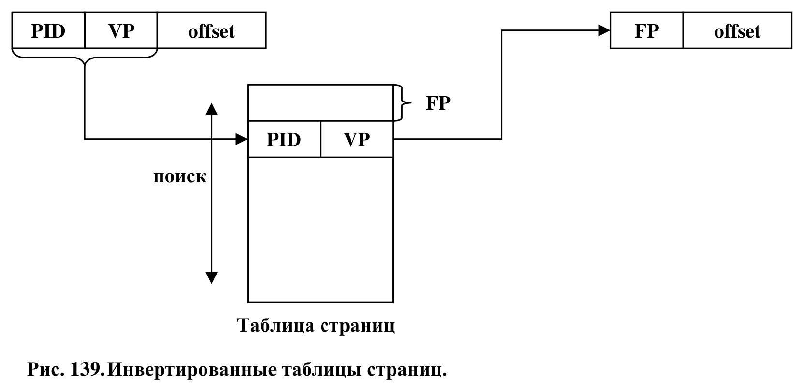

Главный недостаток - на **аппаратном** уровне необходима поддержка работы с PID процесса. (Однако такие процессоры есть)

Главное преимущество такого подхода - таблица страниц для всей системы единственная.

#### Преимущества и недостатки 

Главным преимуществом страничного распределения является отсутствие физического ограничения на размер памяти для процесса (не считая размера регистра). Т.е. теперь программа могла требовать и работать со значительно большей памятью, однако физически в ОЗУ могла оказываться лишь её часть (остальное могло быть выкачано на диск/не существовать физически вовсе)

Из недостатков всё ещё фрагментация внутри страницы, проблема с хранением и переключением контекста страниц, накладные расходы на вычисление физ адреса, сложность архитектуры. (Spoiler - почти никакая из этих проблем далее не решается)

!!! Вообще говоря, в большинстве систем сейчас используется именно страничная система распределения ОЗУ.

#### Выгрузка страниц

Соответственно теперь у нас появляется механизм, позволяющий "выкидывать" неиспользуемые страницы (в постоянную память, например, именуемую swap) и загружать на их место новые. А значит, необходимы и алгоритмы для выбора страниц "на выброс".

##### NRU

Первый алгоритм на рассмотрение - **NRU** (Not Recently Used). 

Алгоритм в своей основе использует два признака **М** (modification, при записи) и **R** (read, при чтении), которые выставляются для каждой из страниц. Также имеется возможность обнулять данные признаки при обращении в ОС.

Принцип алгоритма следующий:
1. Все признаки обнуляются
2. С каким-то периодом времени обнуляются все R-признаки
3. При необходимости выбрать страницу на освобождение выбирается страница из непустого класса с минимальным номером

Классы страниц:
- Класс 0: R=0, M=0 (страница не использовалась)
- Класс 1: R=0, M=1 (в страницу только писали)
- Класс 2: R=1, M=0 (из страницы читали)
- Класс 3: R=1, M=1 (страница активно использовалась)

***Примечание***: операций чтения памяти зачастую кратно больше, чем операций записи в неё => страница, которую читают, более важная (класс 2 выше класса 1)

##### FIFO

Алгоритм, который записывает очередь попадания страниц и в случае необходимости очищает ту, которая дольше всего была в памяти.

Очевидно неэффективный. Есть модификации, которые отдельно вводят R-признак и при его наличии у "старой" страницы выкидывают страницу в конец очереди, очищая R.

Много внимания уделять ему не будем.

##### Часы

В каком-то роде модификация NRU, при которой есть лишь счётчик R. Сбрасывается лишь при прохождении страницы "маркером". Сам список страниц образует циклический список. Если маркер попал на страницу с R=0, страница выкидывается.

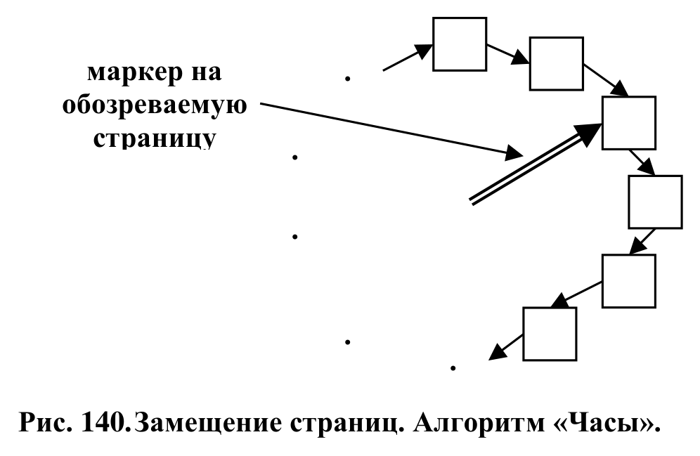

##### LRU

Least Recently Used - алгоритм, который выкидывает последнюю страницу, что читали. Концепция простая, реализация не очень (+ аппаратно требует небольших сложностей)

Строится битовая таблица NxN, при каждом обращении к i-й странице все биты в строке i выставляются в 1, а все биты столбца с номером i обнуляются. При откачке выбираем страницу с наименьшим двоичным номером.

##### NFU

Not Frequently Used

У каждой страницы есть свой счётчик. Через определённые интервалы времени происходит увеличение счётчика на 1, если к странице обращались хоть раз за этот период.

При откачке выбирается страница с минимальным значением счётчика

Недостатки:
- "хранит историю" - если страницу интенсивно использовали, а после не трогали, то она ещё долго провисит в памяти
- может возникнуть переполнение

### 5. Сегментное распределение

Теперь мы (слава богу) заканчиваем со страничным распределением (на деле это не так) и переходим к следующему - сегментному.

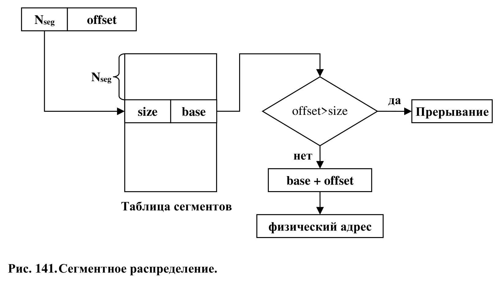

Основным недостатком страничного распределения были блоки фиксированного размера. В "идеальном" мире мы бы хотели, чтобы размеры "блоков" совпадали с логической структурой программы - отдельный виртуальный сегмент под стек, отдельный под кучу, другой под статические переменные и т.д. Данную проблему и решает сегментное распределение. Более того, данное распределение позволяет решить проблему фрагментации.

Соответственно, теперь, при блочном распределении, у нас есть таблица сегментов, в которой для каждого сегмента хранится начало раздела (base) и его размер (size). В виртуальном адресе теперь вместо номера страницы используется номер сегмента (Nseg). При формировании физического адреса проверяется, что offset < size. При невыполнении условия создаётся прерывание.

Преимущества данной модели — простота аппаратной реализации, сокращение фрагментации внутри сегмента, а также возможность хранить сравнительно небольшую таблицу страниц

Из недостатков - сегмент должен полностью размещаться в памяти, из-за чего также пропадает смысл использования подкачки. (Если выгружать из памяти, то только целые разделы, которые могут вскоре целиком понадобиться снова)

### 6. Сегментно-страничное распределение

Основу виртуального адреса также составляют номер сегмента и смещение в нём, также имеется аппаратная таблица сегментов, благодаря которой из виртуального адреса получается *линейный адрес*, который уже представляется как номер страницы и смещение в ней. Данная модель хороша тем, что совмещает в себе преимущества страничного распределения памяти с логическим сегментированием.

Одним из примеров такой реализации является модель, предложенная компанией Intel. 

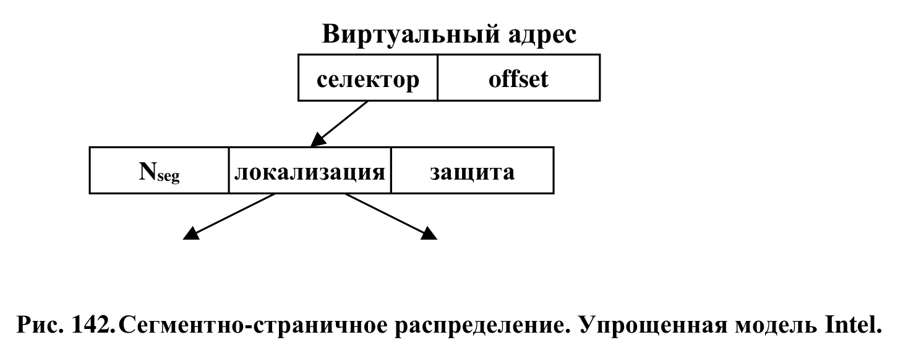

Виртуальный адрес в данной модели представляется в виде селектора и смещения в сегменте. Сам селектор содержит информацию, благодаря которой можно получить информацию о нахождении сегмента. Сегмент бывает 2 типов: локальным, который описывается в LDT (Local Descriptor Table), и глобальным, что описывается в GDT (Global Descriptor Table). Соответственно LDT может быть доступна лишь данному процессу, GDT доступна для всех процессов. Также селектор хранит различную информацию об атрибутах режима доступа к сегменту.

Соответственно преобразование адреса выполняется следующим образом:

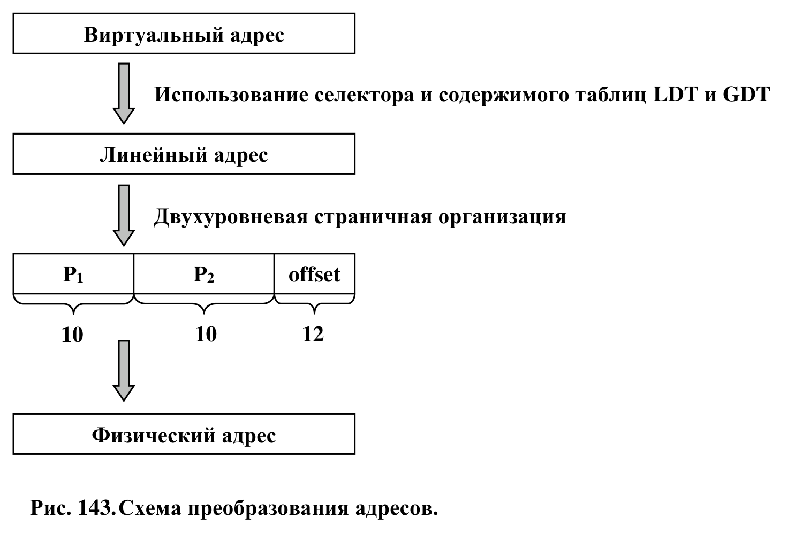

Используется двухуровневая организация страничной памяти после преобразования виртуального адреса в линейный. Последние 12 разрядов отводятся под смещение в физической странице, а первые 20 разрядов интерпретируются как 10-разрядный индекс во «внешней» таблице групп страниц и 10-разрядное смещение в соответствующей таблице второго уровня иерархии.

Из особенностей данной модели - при желании можно "отключать" отдельно сегментную или страничную составляющую модели распределения.

## Интересное про Linux

!!! Спойлер - дальше необязательное, но (вроде) интересное про ОЗУ.

Вообще говоря, ОЗУ - прежде всего *память*, поэтому Linux-система может и использовать её для хранения различных данных. А учитывая, что ОЗУ сохраняет данные, лишь пока есть питание - лучше всего хранить ***временные*** данные.

### `/tmp` - раздел, который mount'ится в ОЗУ

Стандартно этот раздел mount'ится как `tmpfs` в `/etc/fstab` (хотя записи там может и не быть) и используется программами (и пользователем) как раздел, в который скидываются временные, но служебные файлики. ИИ-агенты часто используют его для клона репозитория, написания скриптов для разового теста и т.д.

Идеология такая, что никто не может гарантировать, что записанное туда не сотрётся уже через секунду.

Размер `tmpfs` стандартно ограничен половиной всего объёма ОЗУ (на все mount-point tmpfs). Но на раздел OOM-killer не придёт, очистить автоматически его никто не сможет.

***Примечание:*** вообще говоря, можно смонтировать любой (в пределах разумного) раздел в системе как `tmpfs`, и тогда он будет храниться в ОЗУ. Помимо преимущества в очистке "мусора" после перезагрузки системы, работа с файлами в tmpfs будет гораздо быстрее, т.к. файлы читаются не с диска, а из быстрого ОЗУ

***Примечание 2:*** вообще говоря, `/run` (раздел с кучей информации о состоянии работающей системы) монтируется именно как `tmpfs`. (Логично, что хранить информацию, например, о процессе после выключения компьютера нам нет никакого смысла)

### zram

Наравне с файлом подкачки (swap - место в памяти, куда "выкачиваются" неиспользуемые страницы), для "увеличения" объёма ОЗУ существует и `zram`.

`zram` - механизм, который на части ОЗУ создаёт блочное устройство (/dev/zram0), на котором данные сжимаются (стандартно используется алгоритм сжатия zstd). Само блочное устройство используется (зачастую) как дополнительный swap.

Может использоваться наравне с файлом подкачки на диске и представляет собой компромисс между скоростью чтения/записи и размером swap-пространства. Т.е. пытается совместить лучшее от обоих миров
