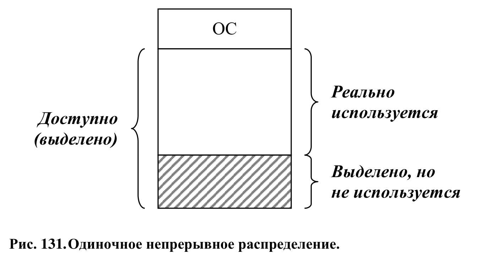
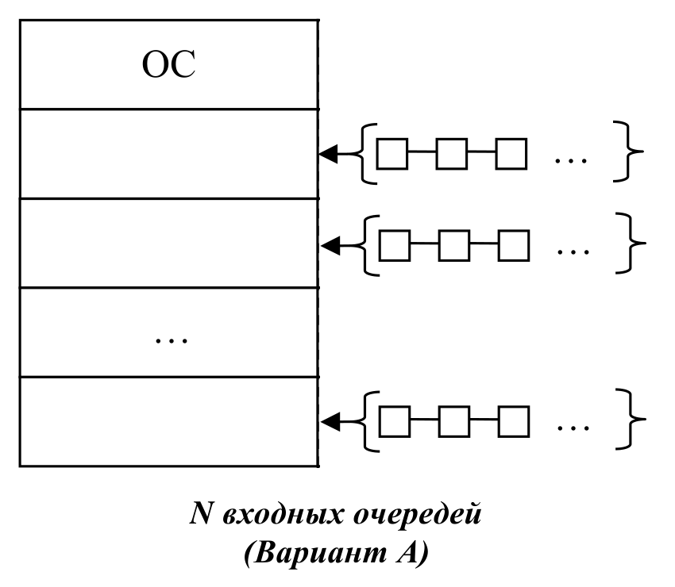
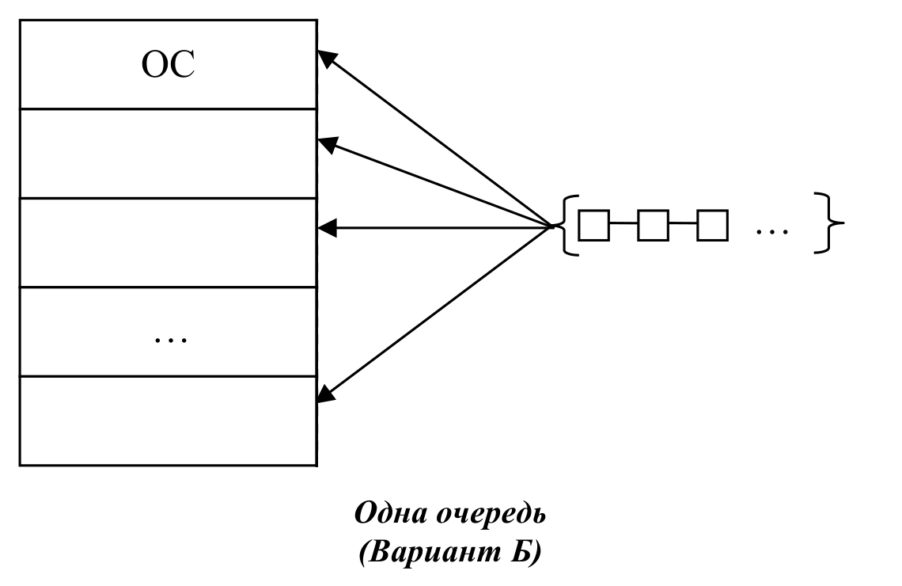
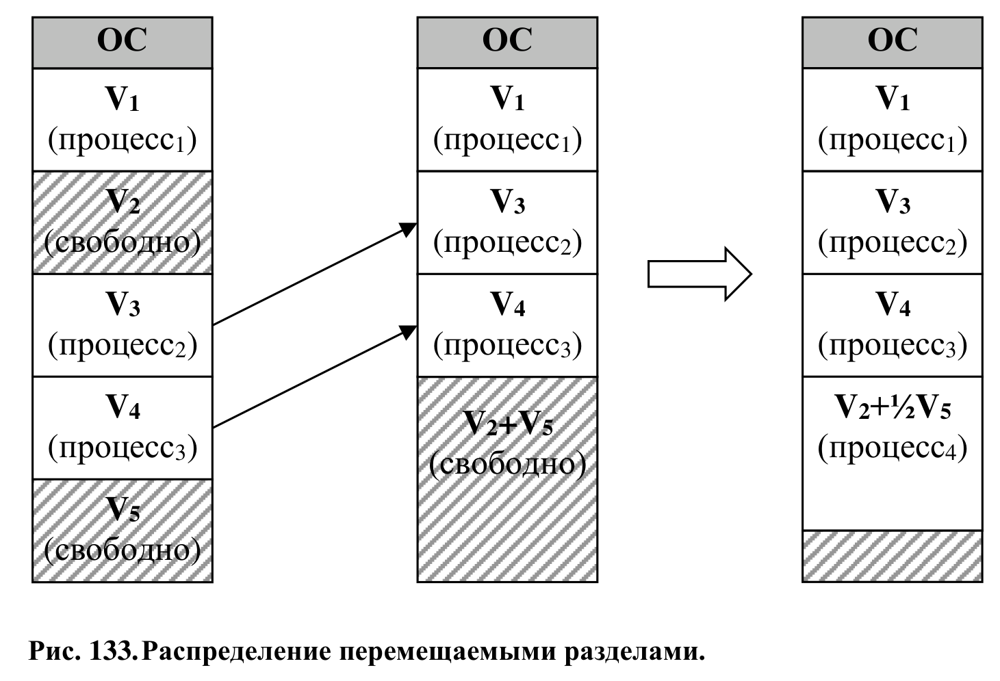
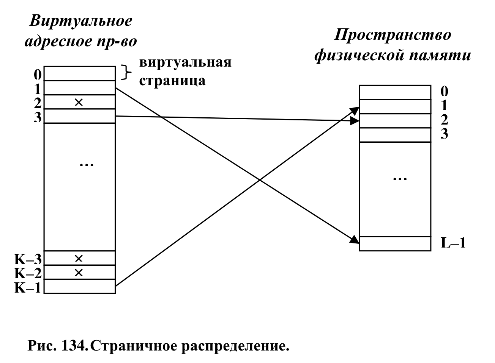

# Особенности структуры виртуальной памяти

Итак, для запуска и работы программы, её необходимо сперва поместить в оперативную память (ОЗУ). И здесь управление оперативной памятью должно решать следующие основные задачи:

1. осуществление контроля использования ресурса (помнить, какие ячейки заняты/свободны)
2. выбор стратегии распределения (какому процессу даётся в пользование ресурс, насколько много и как долго)
3. непосредственно выделение ресурса
4. выбор стратегии освобождения памяти. Здесь может означать как окончательное освобождение (например, при завершении процесса), так и временное освобождение (когда происходит выгрузка во внешнюю память/ПЗУ для предоставления ресурса другому процессу)

## Основные стратегии распределения

Мы рассмотрим 6 основных способов распределения оперативной памяти в порядке их "эволюции":

1. одиночное непрерывное распределение
2. распределение неперемащемыми разделами
3. распределение перемещаемыми разделами
4. страничное распределение
5. сегментное распределение
6. сегментно-страничное распределение

### 1. Одиночное непрерывное распределение

Самая примитив модель. Делим всю память на две части - в одной будет функционировать непосредственно ОС, во второй - пользовательский процесс.

Из дополнительного - необходим регистр для хранения границы пространства ОС. Если адрес больше регистра - память относится к пользовательскому процессу. Меньше - к ОС.

Очевидные недостатоки:

- неэффективное использование памяти (к части ресурсов обращений может не быть вовсе)
- занимаемый процесс использовал сразу всю память
- ограничение максимального размера программы

### 2. Распределение неперемащемыми разделами

Оставляем разделение на 2 части - ОС и пользовательскую.

Однако теперь пользовательское пространство памяти делим ещё на N частей (разделов). В общем случае каждый раздел может иметь произвольный фиксированный размер.

Аппаратно существует два способа поддержки такого разделения

1. Использование для каждого раздела двех регистров границы (начало и конец). Выход адреса за границы - прерывание
2. Для каждого раздела ОЗУ ставится в соответствие "ключ защиты". У процесса, который занял раздел, также есть этот ключ защиты. При обращении процесса к участку памяти проверяется совпадение данных ключей. (называется PSW — process[or] status word)

Из дополнительного аппаратного - каждый процесс должен иметь "регистр базы" для корректной адресации, совпадающий с одним из регистров границы.

Алгоритмов в данной модели распределения также 2

#### Вариант А. N входных очередей

При варианте A создаётся N очередей для процессов, каждая из которых соответствует своему разделу.

Сортировка входных процессов по очередям в данном случае обычно сводится к помещению процесса в очередь, соответствующую разделу минимального размера, способной поместить в себя процесс. Из-за такого подхода на одни разделы может возникнуть очередь, когда в других память будет простаивать. Крайне неэффективное использование

#### Вариант B. 1 входная очередь

Вторым вариантом является выделение лишь одной очереди под все процессы.

И снова два варианта под капотом!

1. Просто выбираем под освободившийся раздел первый процесс из очереди. Просто, но так мы можем поместить "маленький" процесс в большой раздел - неэффективное использование памяти
2. Проходим всю очередь для поиска процесса максимального размера, умещающегося в данный раздел.

Второй подход дискриминирует "малые" процессы. Решение - добавление счётчика, который увеличивается за каждое "невзятие" процесса в раздел. При достижении определённого числа ОС будет обязана взять процесс в освободившийся раздел

Из преимуществ данной модели распределение:

- относительная простота реализации
- несколько процессов свободно находятся в ОЗУ и процессор может быстрее переключаться между выполняемыми процессами

Недостатки:

- всё ещё фрагментация (внутри каждого раздела остаётся неиспользуемая память)
- ограничение размера процесса
- предварительное деление на N разделов
- размещение всего процесса в ОЗУ (часть данных всё ещё может не использоваться)

### 3. Распределение перемещаемыми разделами

При данном распределении процессы загружаются в память "последовательно". Основной "шаг эволюции" в данном методе - избавление от фрагментации.

Стратегии "компрессии" (перемещение разделов для объединения блоков свободной памяти) могут быть разными (нам надо как можно сильнее оптимизировать перемещение разделов, т.к. это сильные затраты на время), в их детали вдаваться не будем.

Из аппаратного необходимого - также регистры границ или ключ защиты, регистр базы, а также механизм, позволяющий двигать весь процесс в памяти.

Отдельно данная система хорошо себя показывает, когда каждый процесс является "большим вычислительным", т.е. достаточно долго сидит в памяти, чтобы время на компрессию не было таким значимым.

Преимущества:

- все прошлые + уменьшение фрагментации

Недостатки:

- компрессия может занимать значительное время на перемещение разделов
- все прошлые (не считая фрагментации)

### 4. Страничное распределение

Наконец мы подходим к более вкусным реализациям. В том числе к появлению _виртуального адресного пространства_.

